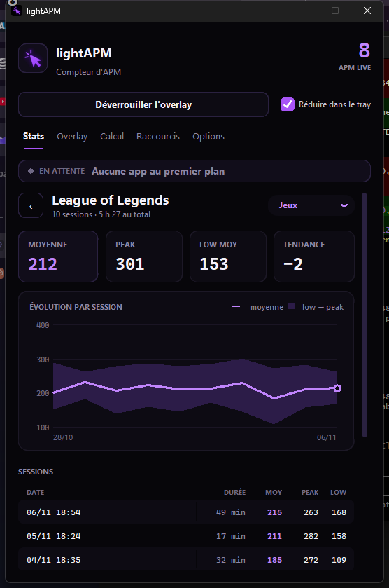
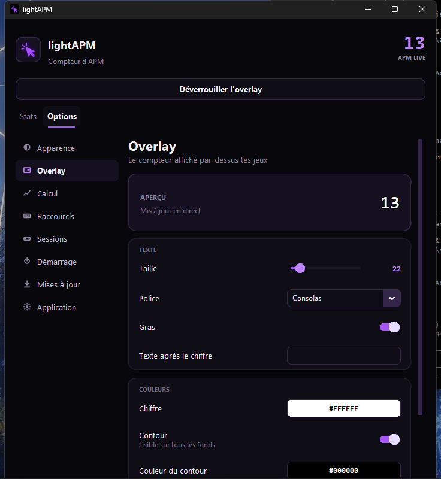

# lightAPM

Compteur d'APM (actions par minute) léger pour Windows : un chiffre discret par-dessus tes jeux, et des stats
par jeu qui s'accumulent session après session.

<p>
  
  
</p>

## Fonctionnalités

- **Overlay** : le chiffre seul, fond transparent, verrouillable (les clics le traversent en jeu).
- **Stats par jeu** : le jeu au premier plan est détecté automatiquement. Pour chaque session : moyenne,
  peak (meilleure minute) et low (pire minute active), avec historique et courbe d'évolution.
- **Pause AFK** : sans input, les APM se figent et reprennent dès que tu rejoues.
- **7 thèmes** de couleur, un assistant de configuration au premier lancement.
- **Lancement avec Windows** (optionnel), réduction dans la zone de notification.
- **Mises à jour** : proposées au démarrage, jamais installées sans ton accord.

Les navigateurs ne sont pas comptés.

## Installation

1. Télécharge le projet : bouton **Code › Download ZIP**, puis décompresse-le où tu veux.
   Ou avec Git : `git clone https://github.com/Kaiokrr/lightAPM.git`
2. Double-clique sur **`lightAPM.exe`**.

Au premier lancement, `lightAPM.exe` :
- vérifie que Python 3.9+ est installé, et propose de l'installer s'il manque (via winget, sans droits admin) ;
- installe les composants nécessaires (une seule fois, environ une minute) ;
- ouvre l'assistant de configuration.

Ensuite, il lance l'app directement.

> **Windows SmartScreen** peut afficher « Windows a protégé votre ordinateur », parce que l'exe n'est pas
> signé. Clique sur **Informations complémentaires › Exécuter quand même**. Le code source du lanceur est dans
> [`launcher/launcher.py`](launcher/launcher.py).

## Raccourcis

| Touche | Action |
| --- | --- |
| `F8` | Verrouiller / déverrouiller l'overlay (déverrouillé : glisse-le où tu veux) |
| `F9` | Afficher / masquer l'overlay |

Modifiables dans **Options › Raccourcis**.

## Où sont mes données ?

Dans le dossier `data/` à côté de l'exe : `config.json` (réglages) et `stats.json` (tes sessions).
Ce dossier n'est jamais envoyé sur GitHub. Pour repartir de zéro, supprime-le.

## Structure du projet

```
lightAPM.exe          lanceur : installe ce qu'il faut et démarre l'app
app/lightapm.py       l'application
app/assets/           logo et icônes
launcher/             code source du lanceur + script de compilation
requirements.txt      dépendances Python
version.json          dernière version publiée (lu par l'app pour proposer les mises à jour)
data/                 tes réglages et stats (créé au premier lancement, ignoré par Git)
```

## Développement

Lancer depuis le code :

```
pip install -r requirements.txt
pythonw app/lightapm.py
```

Recompiler le lanceur :

```
pip install pyinstaller
launcher\build.bat
```

### Publier une mise à jour

1. Dans `app/lightapm.py`, augmente `VERSION` et ajoute les nouveautés dans `NOUVEAUTES`.
2. Mets à jour `version.json` (même numéro de version, notes).
3. Pousse sur GitHub.

Les utilisateurs se voient proposer la mise à jour au démarrage. L'app télécharge le nouveau
`app/lightapm.py`, vérifie qu'il est valide, garde une copie `.bak`, puis redémarre.

Pour que ça marche, `UPDATE_URL` dans `app/lightapm.py` et `url` dans `version.json` doivent pointer vers
ton dépôt (`https://raw.githubusercontent.com/<pseudo>/<dépôt>/main/...`).
