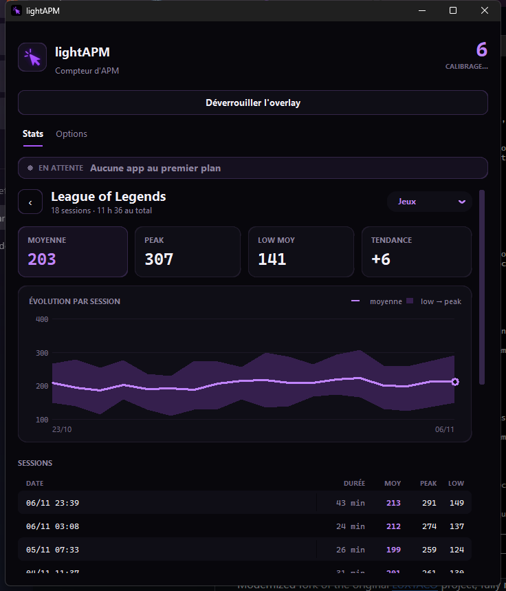
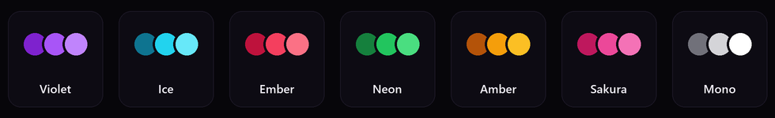

<div align="center">


# lightAPM

**Your live APM on top of your games, and your stats for every game, session after session.**


[](LICENSE)

### [Download lightAPM](https://github.com/Kaiokrr/LightAPM/releases/latest/download/lightAPM.zip)

<sub>Unzip it, double-click <code>lightAPM.exe</code>. That's it.</sub>

<sub><b>English</b> · <a href="README.fr.md">Français</a></sub>

</div>

<br>

<table>
  <tr>
    <td align="center" width="33%"><br><sub><b>Your games</b> · average and peak of each</sub></td>
    <td align="center" width="33%"><br><sub><b>Game detail</b> · chart and history</sub></td>
    <td align="center" width="33%"><br><sub><b>Options</b> · live overlay preview</sub></td>
  </tr>
</table>

## What lightAPM does

| | |
| --- | --- |
| **Unobtrusive overlay** | Just a number on a transparent background, anywhere on your screen. Once locked, clicks go right through it, so it never gets in the way in game. |
| **Per-game stats** | The game you're playing is detected automatically. Every session records your average, peak and low, and your stats add up over time. |
| **Progress chart** | For each game: your average session after session, the range between your low and your peak, and your recent trend. |
| **AFK pause** | Step away from the keyboard and your APM freezes. Come back and it picks up exactly where it left off. |
| **End-of-game summary** | A small card at the bottom of the screen with the session's average, peak and low. |
| **English or French** | English by default; switch to French in the setup assistant or in **Options › Appearance**. |
| **One-click install** | `lightAPM.exe` installs everything it needs on first launch, then walks you through the settings. |
| **Start with Windows** | Optional, in the notification area, no administrator rights needed. |
| **Updates** | Offered on startup, never installed without your OK. |

## Installation

1. **[Download the ZIP](https://github.com/Kaiokrr/LightAPM/releases/latest/download/lightAPM.zip)** and unzip it wherever you like (for example in `Documents`).
2. Double-click **`lightAPM.exe`**.
3. Follow the assistant: language, theme, what counts as an action, startup. It takes about a minute.

On first launch, `lightAPM.exe` checks that Python is installed. If it isn't, it downloads the official
installer from python.org, verifies it and installs it for you (with your OK, no administrator rights
needed). It then installs the components lightAPM needs. This takes a minute or two and only happens once.

> [!NOTE]
> Windows may show **"Windows protected your PC"** because the exe isn't signed (a certificate costs a lot for
> a free project). Click **More info**, then **Run anyway**. The launcher's source code is readable in
> [`launcher/launcher.py`](launcher/launcher.py).

With Git: `git clone https://github.com/Kaiokrr/LightAPM.git`

## How the stats are calculated

- **Live APM**: your actions over the last 60 seconds (adjustable), scaled to one minute. During the first
  minute, the header shows "Calibrating" and the number ramps up smoothly, with no fake spike at launch.
- **One action** = a key press, a click or a mouse wheel notch (each can be turned off). Holding a key down
  only counts once.
- **Session average**: all your actions divided by your actual playing time (AFK breaks excluded).
- **Peak**: your best full minute of play.
- **Low**: your worst active minute of play (AFK minutes don't count).
- **Session**: starts when the game comes into focus on your main screen, and ends when you close it or stay
  away from it for more than 5 minutes (adjustable). Sessions shorter than one minute are ignored.

Web browsers (Chrome, Edge, Firefox, Opera, Brave…) are never counted.

## 7 themes



Pick one in the setup assistant or in **Options › Appearance**.

## Hotkeys

| Key | Action |
| :---: | --- |
| <kbd>F8</kbd> | Lock / unlock the overlay. Unlocked, drag it wherever you want: its position is remembered. |
| <kbd>F9</kbd> | Show / hide the overlay |

You can change them in **Options › Hotkeys**.

## FAQ

<details>
<summary><b>Does lightAPM record what I type?</b></summary>
<br>
No. It counts actions; it doesn't keep the keys. Everything stays on your PC, in the <code>data/</code> folder.
The only Internet connection is used to check whether a new version exists (you can turn it off in <b>Options › Updates</b>).
</details>

<details>
<summary><b>Can it cause problems with an anti-cheat?</b></summary>
<br>
lightAPM doesn't touch the game: it doesn't read or modify its memory and doesn't inject anything. It listens to
the keyboard and mouse at the Windows level and checks which window is in focus, like a regular overlay app.
</details>

<details>
<summary><b>Where are my stats? How do I start over?</b></summary>
<br>
In <code>data/stats.json</code> (and your settings in <code>data/config.json</code>), next to the exe.
To delete a single game: open it in the Stats tab, then <b>Delete</b>. To erase everything: delete the <code>data/</code> folder.
</details>

<details>
<summary><b>A game is listed under "Apps" instead of "Games"</b></summary>
<br>
Open it in the Stats tab and change its category with the menu at the top right. You can rename it too.
</details>

<details>
<summary><b>How do I uninstall it?</b></summary>
<br>
If you turned on <b>Start with Windows</b>, turn it off first in <b>Options › Startup</b>. Then just delete the folder.
</details>

<details>
<summary><b>For developers</b></summary>
<br>

```
lightAPM.exe          launcher: installs what's needed and starts the app
app/lightapm.py       the application (customtkinter, pynput, pystray, Pillow)
app/assets/           logo and icons
launcher/             launcher source code + build.bat to compile it
requirements.txt      Python dependencies
version.json          latest published version, read by the app to offer updates
data/                 user settings and stats (created on launch, ignored by Git)
```

**Run from source**

```
pip install -r requirements.txt
pythonw app/lightapm.py
```

**Rebuild the launcher**: `pip install pyinstaller`, then `launcher\build.bat`.

**Translations**: every visible text is written as `T("English", "Français")` in `app/lightapm.py`.

**Publish an update**

1. In `app/lightapm.py`, bump `VERSION` and add the changes to `NOUVEAUTES` (in English and French).
2. Put the same number in `version.json`, with the English notes in `notes` and the French ones in `notes_fr`.
3. Push to `main`.

On their next launch, users are offered the update. The app downloads the new `app/lightapm.py`, checks that
it's valid, keeps a `.bak` copy, then restarts and shows "What's new".
</details>

<br>

<div align="center">
<sub>Made by <a href="https://github.com/Kaiokrr">Kaiokrr</a> · Code under the <a href="LICENSE">MIT license</a>: free to use, modify and share</sub>
</div>
